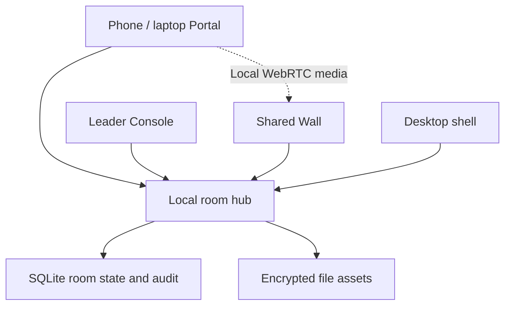

# Borderless architecture and protocol

## Chosen implementation

One Node.js 24 local hub serves a buildless ES-module web application. Node's SQLite module provides transactional local state; `ws` provides WebSockets; `qrcode` generates invitation QR codes locally; `bonjour-service` provides opt-in local discovery. Electron wraps the same application for native desktop responsibilities. No frontend framework, remote database, analytics CDN, SaaS backend, API key or cloud relay is required at runtime.

The source explored several possible language stacks, repeatedly replacing incomplete snippets. Language count is not a product requirement. This implementation makes one data model and protocol executable rather than treating Rust, Go, C++, C# and mobile fragments as interchangeable finished components. Future native drivers can communicate with this hub through an authorised adapter.

## Authority and persistence

Every room has an unpredictable ID, a participant code, a separately hashed leader password and one-use wall pairing state. Session cookies contain 256-bit random bearer secrets; only SHA-256 token digests are stored in SQLite. The cookie path is that room's API subtree, with HttpOnly, SameSite Strict and Secure under TLS. Sessions expire after twelve hours. Creating new sessions does not reuse a client-provided identity.

The hub derives the actor from the cookie. CSRF tokens are delivered in the authenticated snapshot and required on mutations. Host and Origin checks reject unrelated origins. A client-provided role, name, device ID, colour, path, quiz correctness or drawing grant is never authoritative.

Room state is stored as a versioned JSON document inside SQLite. Mutations, command receipts and audit rows commit in a single transaction. Each card has its own version to reject stale movement, edit or resize attempts. A command ID deduplicates a retry within the room/device scope for that session's entire lifetime. At startup and every 30 seconds, inactive credentials and their command receipts are retired transactionally. Active session receipts are retained. Expired drawing grants, hand requests, targeted inbox entries and stream advertisements are also removed, while contributions, quiz results, assets and the audit remain. Retention of room content and the append-only audit still needs an operator policy. SQLite row deletion is not physical erasure of database pages or backups.

Tables: `rooms`, `sessions`, `assets`, `commands`, `cleanup_queue`, `audit`. File bytes live outside SQLite in `<data>/assets/<server-generated-uuid>.blf`. Only the hub data directory is writable at runtime. A `hub.lock` prevents two app instances sharing that directory. After an unclean shutdown, an operator must confirm the host is stopped before removing a stale lock.

## HTTP API

| Method / route | Authority | Behaviour |
| --- | --- | --- |
| `GET /api/health`, `/api/capabilities` | Public | Minimal liveness and truthful capability data. |
| `POST /api/rooms` | Rate-limited creation | Create room and first leader session. |
| `GET /api/rooms/:id/info` | Public | Room name, mode and ended flag; no password, code, roster or content. |
| `POST .../join` | Current participant code | Create participant session. |
| `POST .../login` | Leader password | Create returning leader session. |
| `POST .../wall-pair` | One-use pairing secret | Create display-only session; consume pairing secret. |
| `GET .../state` | Room session | Filtered authoritative snapshot, roster and that device's CSRF token. |
| `GET .../invite` | Leader / display | Invitation link, code and locally generated QR. |
| `POST .../pair` | Leader + CSRF | Generate a replacement one-use display link. |
| `POST .../command` | Room session + CSRF + command-specific role | Apply validated command and broadcast state. |
| `POST .../upload` | Contributor + CSRF | Raw binary file body, URL-encoded `X-Filename`; bounded streamed encryption then transactional card. |
| `GET .../assets/:assetId` | Session in the same room | Authenticate/decrypt/verify before returning bytes; single byte ranges for media. |
| `GET .../assets/:assetId?download=1` | Session in the same room | Explicit attachment download. |
| `GET .../audit` | Leader | Room-scoped event chain and verification. |
| `GET .../export` | Leader | JSON snapshot, asset manifest and audit head, without file bytes. |
| `POST .../logout` | Device session + CSRF | Revoke this device session and disconnect its sockets. |

Important commands are implemented in `server/app.mjs`: `note.add`, `item.move`, `item.resize`, `item.edit`, `item.remove`, `room.layout`, `room.theme`, `room.effect`, `room.lock`, `room.clear`, `room.purge`, `room.end`, `invite.rotate`, `hand.raise`, `hand.approve`, `hand.deny`, `hand.revoke`, `device.evict`, `seat.change`, `stroke.add`, `stroke.undo`, `ink.clear`, `delivery.send`, `delivery.accept`, `quiz.start`, `quiz.answer`, `quiz.close`, `quiz.dismiss`, `stream.start`, `stream.stop`.

## Live protocol

`GET /api/rooms/:id/live` upgrades an authenticated room session. The server sends a connection-specific `hello`, then the actor-filtered room snapshot. Snapshot messages carry a global room revision; ephemeral input never edits persistent state directly.

| Event | Direction | Validation and lifetime |
| --- | --- | --- |
| `hello` | Hub → connection | Unique connection ID for targeted WebRTC, separate from stable device ID. |
| `state` | Hub → connection | Authoritative per-actor snapshot after changes or reconnect. |
| `pointer` | Both | Normalised finite coordinates and server-derived actor; paused/read-only actors rejected; not durable. |
| `ink.preview` | Both | Requires current drawing authority; not durable. Committed ink uses `stroke.add`. |
| `rtc` | Both | `ready`, `offer`, `answer`, `candidate`; route only between the stream owner and a current leader/display, optionally to one connection ID. |
| `ping` / `pong` | Both | Round-trip measurement; transport heartbeat independently retires dead peers. |
| `canvas.cleared`, `streams.stopped` | Hub → room | Stop local representations and media lifetimes. |
| `error` | Hub → connection | Refused event without modifying room state. |

Inbound frames are limited to 64 KiB, SDP/signalling payloads to 32 KiB, per-device events to 180/second and outgoing socket backlog to 1 MiB. Slow clients are disconnected and must obtain a fresh snapshot. A server ping runs every ten seconds. Pointer client visuals expire stale reticles after about 2.5 seconds. HTTP and authentication endpoints have separate rate limits.

WebRTC uses no external ICE servers. That means no unsolicited third-party STUN/TURN traffic and no guarantee across isolated VLANs, NAT or internet links. Media transport is not proxied through the JSON WebSocket. Audio activation obeys user gesture and platform capture restrictions. Multiple tabs under one device identity use connection-specific routing to avoid mixing SDP negotiations.

## File integrity and rendering

An upload streams through a size limit and SHA-256 accumulator into AES-256-GCM encryption. The file format is `BLF1 | 12-byte nonce | ciphertext | 16-byte authentication tag`. The storage key is generated once, is local to the data directory and has mode 0600. Authentication of the GCM tag and comparison of plaintext hash/size happen before a download response body is released. The maximum file size bounds decryption memory.

Filename extension and a small magic-byte check select the permitted MIME type. Active HTML, JavaScript, SVG and executables are not accepted. These checks do not replace malware scanning, document sanitisation or a trusted host application's protections. Office files are downloads, not server-executed processes. A restrictive sandbox CSP and nosniff header apply to returned content. The native shell verifies the file hash again, asks the local operator and uses an allowlisted data extension before calling the OS default application.

Encrypted asset writes and SQLite commits are two separate durability boundaries. A process failure between them can leave an orphan file, and a failed purge unlink can leave inaccessible ciphertext. No file is served without a live asset row. Purge writes a durable cleanup job in the same transaction that removes access. Cleanup is awaited before its response, reports pending failures to the leader, retries every 30 seconds and can be retried explicitly. Startup reconciles abandoned `.part` files and orphan ciphertext against authoritative asset rows. Deletion/recovery fault tests cover both paths. This is logical storage lifecycle management, not a promise of hardware secure erasure or recall of downloads/backups.

## Rendering and spatial model

Canvas coordinates are normalised to a bounded shared viewport. Card positions, sizes and ownership are authoritative. Each client scales them to its display. The WebGL arrival layer is decorative and bounded; reduced motion and lack of WebGL leave contributions functional. The whiteboard uses persisted vector points rendered as SVG. Shared media elements retain independent lifetimes rather than being rebuilt for every state update.

Themes are room state. Leader changes propagate to all clients. There are no runtime web font or external image dependencies. The desktop shell can place the same Wall on a display or span a software viewport across connected display bounds. It does not assert synchronised scanout across physical panels.

## Native boundary

Electron preload exposes only an edge event subscription, a native file-open request and a capability object. Node integration is off, context isolation and renderer sandboxing are on, and navigation/popups stay within the configured hub origin. Main-frame IPC origin checks and local file-open confirmation protect the OS boundary. Global pointer observation can produce an edge cue; it cannot create a virtual monitor.

The embedded hub runs in an Electron utility process, rather than the native main thread. macOS native dialogs can suspend that thread: a source picker must not suspend HTTP/WebSocket traffic for everyone in the room. A private process message announces readiness; graceful quit asks the child to close the hub and release its lock. Startup timeout and child failure are reported, and shutdown has a bounded kill fallback. A forced termination can still require the documented stale-lock recovery step. A desktop instance lock brings an existing instance forward rather than starting a conflicting hub. Display metric changes refresh the placement menu.

The native permission handler recognises Chromium's local-network and loopback request types. A trusted main-frame hub can request explicit operator approval; cross-origin/subframe requests and unrelated capabilities are denied. Concurrent requests share a prompt, approval lasts for the desktop session and a navigated/destroyed requester loses the pending grant. OS Local Network consent is a separate boundary; the Mac package declares its purpose and Bonjour service type.

True Windows IDD integration, supported macOS virtual display strategy, full global pointer handoff, native mobile capture and hardware synchronisation remain separate platform work. Their contracts, release gates and source research are recorded rather than represented by non-functional driver snippets.
