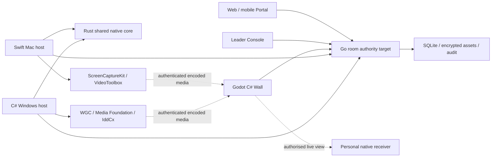

# Native architecture and migration decision

ADR 001 · 3 November 2026 · Restores the original Go/Rust/C# reference; platform refinements below are engineering recommendations, not a claim of user acceptance or completed native delivery.

## Decision

Keep **Go for the authoritative room hub, Rust for shared native system logic, and C#/.NET with Godot for the spatial Wall**. Use a **thin Swift Mac adapter** and **Windows-specific C#/C++ adapters** for OS APIs. The same protocols, grants and coordinate model connect them. A Mac does not need to impersonate a PC, and the operating systems do not need to run the same capture code.

This is better aligned with the original product than continuing to treat the Electron shell as its final system layer. It also adds language/build complexity; stable boundaries and conformance tests are mandatory. There is no evidence that replacing languages alone reduces end-to-end latency. The reason is direct access to supported capture, encode, display, input and lifecycle APIs.

The web Portal remains a shipping component. The existing Node hub is the sole current room authority until a Go replacement passes full protocol/storage conformance. It is a compatibility baseline, not a second authority or an excuse to defer native work. No user data is automatically migrated by this change.

The diagram describes the target. Current components and evidence are separately listed in CAPABILITIES and BUILD_HANDOFF.

## Component ownership and code locations

| Component | Location | Owns | Must not own |
| --- | --- | --- | --- |
| Rust core | `native/core/` | Display geometry, edge transforms, capture readiness/loss policy; later media-session/input lease state and bounded frame ownership. C ABI shared by Swift and .NET. | Hub authorisation, credentials, UI widgets, pretending a coordinate calculation is a driver. |
| Mac adapter/host | `native/macos/` | AppKit/SwiftUI windows, OS picker/consent, ScreenCaptureKit frames, VideoToolbox encode, native lifecycle/display/input adapters. | Private virtual-monitor APIs hidden as public support; independent room permissions. |
| Windows integration | `native/windows/` | C# application host and C++ WGC/D3D11/Media Foundation bridge; separately packaged IddCx driver. | Networking secrets or general UI inside the UMDF driver; unreviewed kernel code. |
| Shared .NET client | `native/dotnet/` | Typed bounded room client, native-core binding and model consumed by Wall/Windows host. | TLS bypass, client-selected roles, background-thread Godot scene mutations. |
| Native Wall | `native/wall/` | Godot scene, content nodes, shared transforms, material effects, per-display output, independent content lifetimes and audio output policy. | Authority based on local scene state; replacing previews with filename labels. |
| Go control plane | `native/hub/` | Typed commands, trusted actor context, validation; progressively room/session/storage/audit/transport migration. | Raw frame relay through JSON sockets, dual-writing current database. |
| Contract | `native/protocol/` | Versioned requirements, fixtures and boundary semantics. | Runtime secrets or claiming schemas implement transport. |
| Existing compatibility implementation | `server/`, `public/`, `desktop/` | Current authoritative behaviour and tested Portal/security reference. | Defining the final native scope by its current limits. |

Empty platform work is documented as outstanding rather than padded with misleading “driver” source files. Native diagnostics use the actual reusable adapter/core; they are developer tools, not a substitute product or another standalone demo architecture.

## Mac path

Use Swift for OS-facing behaviour. macOS 14 is the initial local validation floor because the system content picker is available there and this machine runs 14.5. ScreenCaptureKit delivers window/display buffers; VideoToolbox is the proposed hardware encoder. AppKit manages personal windows; SwiftUI can provide compact controls. The reusable capture service must verify complete frames, detect a first-frame timeout/stall, stop on source failure and expose permission failure honestly.

[Apple's capture sample](https://developer.apple.com/documentation/screencapturekit/capturing-screen-content-in-macos) demonstrates filters/stream outputs. Its current sample needs macOS 15, so do not blindly import newer sample APIs into a 14 deployment target. Check the installed SDK availability and compile the actual code. Use the [system sharing picker](https://developer.apple.com/documentation/screencapturekit/sccontentsharingpicker), not blanket capture at launch.

**Virtual-display creation is unresolved.** ScreenCaptureKit captures an existing source; it does not create a monitor. CoreMediaIO is not the solution to display extension. No supported public software virtual-display API was established by this review. Private CGVirtualDisplay use in other projects is not proof of a supported distributable API. Options to investigate: an Apple-supported entitlement/partner route; a properly labelled physical/USB display adapter; or an explicitly accepted private-API/distribution trade-off. None is silently selected. Ordinary live window sharing can progress independently but does not close B25.

## Windows path

Use C#/.NET for the participant/operator host; WGC and D3D11 through a small C++/WinRT bridge for selected window/display capture, Media Foundation or qualified GPU encoders for compression, and **IddCx/UMDF** for a real virtual monitor. Rust shares geometry/lifecycle/policy through the same C ABI used on Mac.

Microsoft's [IDD overview](https://learn.microsoft.com/windows-hardware/drivers/display/indirect-display-driver-model-overview) and [IndirectDisplay sample](https://github.com/microsoft/Windows-driver-samples/tree/main/video/IndirectDisplay) are the starting point. The driver receives desktop surfaces; capture/encode/IPC are still engineering work. Driver signing, WDK/HLK, adapter modes, standard-user runtime, sleep/hotplug and disconnect recovery are separate acceptance gates. Do not copy the sample and report a finished Borderless driver.

Remote input is opt-in. Secure desktop/UAC/protected content is not bypassed. Every acquired input lease is connection-scoped and expires; Escape, process failure and network loss release keys/buttons before handing control back.

## Native Wall and media

Godot C# remains the agreed native visual direction: one shared scene of actual content, a viewer transform, floating tools, restrained GPU effects, independent live surfaces and local personal windows. Keep networking off the scene thread; enqueue validated snapshots and apply on the Godot main thread. Preserve media decoder nodes across position/size changes. Per-head rendering is distinct from a large fullscreen window and from hardware frame lock.

Start interoperable media with a qualified H.264/Opus profile over WebRTC; H.265/AV1 are optional negotiated additions, not assumed universal. Use established ICE/DTLS/SRTP implementations. Pion is a strong Go transport/reference candidate; libdatachannel is a native candidate with MPL obligations. Select one production native transport after a capture-to-decoder test; do not implement both redundant stacks by default. Raw media does not travel through hub JSON events.

Capture → complete frame → bounded surface queue → hardware encoder → authenticated media transport → decoder → GPU texture → render. Carry monotonic timestamps and colour metadata. Surface handles remain within allowed processes; network packets contain encoded data, never raw pointers. Slow receivers drop obsolete frames; keyframe requests and congestion control recover. Audio shares timing and stops with its source; only selected outputs play it.

## Protocol and state

Retain existing session/room isolation and actor-filtered snapshots during migration. A versioned envelope identifies protocol version, room, request and expected revision; authenticated transport supplies the actor. Reject unknown versions, extra authority fields, malformed/oversized/fragmented payloads and non-finite geometry. Reliable commands use deduplicated receipts. Pointer/ink previews are ephemeral and bounded; durable strokes/assets/layout commit atomically.

Separate source/capture ID, actor/device ID and connection ID. A capture grant cannot be reused for a later capture. Invitation and control lease are distinct. Recheck grant/session on signalling and revocation; native clients are not trusted more than browsers. Runtime capability reports distinguish supported, unavailable, denied, starting, receiving frames, stalled and stopped.

FFI v1 passes fixed-layout numeric structs, never borrowed object graphs or exceptions. Caller owns returned values; invalid parameters return explicit failure. No capture pixels/keys/paths in diagnostic logs. The small initial C ABI is preferable to adding a binding generator for three functions. [UniFFI](https://github.com/mozilla/uniffi-rs) is a later option as the object model grows; its C# support is third-party and needs qualification.

## Migration without data loss or another rewrite

1. Native components consume existing authoritative behaviours. Keep fixtures independent of JavaScript implementation details. Record native evidence separately.
2. Implement Go parity incrementally: sessions/roles/CSRF, command receipts, filtered snapshots, assets, audit and lifecycle. Test all current integration scenarios against an adapter with the same semantics, not a new insecure broadcast server.
3. Design a versioned offline importer: stop current hub, verified backup, read-only export, preserve IDs/ownership/geometry/hash chains, re-encrypt only with verified keys, invalidate sessions, validate restored files and counts. Never copy live SQLite blindly.
4. Cut over one authority at a time. Old hub remains stopped. Rollback restores a compatible checkpoint; it does not run two writers or erase newer work.
5. Retire Electron only after native source selection, content rendering, personal windows, safe-open, reconnect and room flows meet or exceed the existing evidence. Retire Node runtime only after Go conformance and migration/rollback pass. Retained code is not a claim of stack approval.

## Alternatives and explicit recommendations

| Option | Assessment |
| --- | --- |
| Continue Electron as complete product | Fast reuse of current UI, but does not itself deliver native driver/edge/media integration and was not the agreed architecture. Keep compatibility only. |
| All Swift on Mac, unrelated Windows app | Native feel, but risks divergent room semantics. Thin adapters over common contracts/core are preferable. |
| All .NET with platform bindings | Technically feasible; Rust is not mandatory for speed. Would discard the original shared system-core decision without evidence. No substitution proposed. |
| Rust everywhere, including all OS UI/driver APIs | Reduces some language variety but increases binding/tooling effort. Supported Swift and C++ platform APIs are the practical refinement. |
| Replace Godot with a bespoke renderer/Unity | No measured reason to do so now. Keep Godot; qualify texture import, accessibility, text/document rendering and per-head output early. |
| Adopt entire Sunshine/RustDesk product | Valuable engineering references; different product model/licences. Do not fork them and call their remote desktop flow Borderless. |

Use maintained pinned toolchains, not the conversation's old minimums as permanent versions. Local baseline for this revision is Rust 1.88, Swift 6.0.3/macOS 14 SDK availability, Go 1.24.4 and a qualified .NET SDK. .NET 10 is the recommended LTS uplift from the source's 8/9; compile/qualify the chosen Godot SDK and record exact versions. This version uplift preserves the stack and avoids freezing obsolete tooling.

## Completion gates

Native source compiles ≠ OS capture produces frames ≠ frames cross a LAN ≠ real virtual display ≠ usable spatial product ≠ signed distributable release. Report each separately. Required next proof is a real consented native capture feeding a native receiver in the same authoritative room; Windows/physical phones/multihead/input/driver signing cannot be certified from this Mac alone.
